# Event Center Dordrecht — sub-page build spec (SHARED)

You are building ONE extra page for an existing site. It MUST look like it was made by the
same designer as the homepage. Read `index.html`, `css/styles.css` and `css/pages.css`
BEFORE writing anything, and reuse their classes. Do not restyle existing components.

## Output
- One HTML file at the project root (filename given in your task).
- One page-specific CSS file `css/<page>.css` for anything NOT already covered by
  `styles.css` / `pages.css`. Link order in <head>: styles.css, pages.css, then your page css.
- Never edit `styles.css`, `pages.css`, `js/main.js` or other pages. Only your two files.

## Exact <head> (copy, set the <title> and your page css href)
```html
<meta charset="UTF-8">
<meta name="viewport" content="width=device-width, initial-scale=1.0">
<title>… — Event Center Dordrecht</title>
<meta name="description" content="…">
<link rel="preconnect" href="https://use.typekit.net" crossorigin>
<link rel="preconnect" href="https://fonts.googleapis.com">
<link rel="preconnect" href="https://fonts.gstatic.com" crossorigin>
<link rel="stylesheet" href="https://use.typekit.net/epz3xln.css">
<link rel="stylesheet" href="https://fonts.googleapis.com/css2?family=Allison&display=swap">
<link rel="stylesheet" href="css/styles.css">
<link rel="stylesheet" href="css/pages.css">
<link rel="stylesheet" href="css/<page>.css">
```

## Exact HEADER (paste as first thing in <body>; add aria-current="page" to the link of the current page)
```html
<header class="site-header" data-header>
  <div class="site-header__inner">
    <nav class="nav nav--left" aria-label="Hoofdmenu">
      <a href="index.html">Home</a>
      <a href="bruiloft.html">Bruiloft</a>
      <a href="zaal.html">Zalen</a>
      <a href="over-ons.html">Over ons</a>
      <a href="index.html#reels">Gallerij</a>
      <a href="contact.html">Contact</a>
    </nav>
    <a href="index.html" class="site-header__logo" aria-label="Event Center Dordrecht">
      
    </a>
    <div class="nav nav--right">
      <a href="tel:+31623232334">+31 6 23 23 23 34</a>
      <a href="mailto:info@ecodordrecht.nl">info@ecodordrecht.nl</a>
    </div>
    <button class="nav-toggle" data-nav-toggle aria-label="Menu openen" aria-expanded="false">
      <span></span><span></span>
    </button>
  </div>
</header>
```

## Exact FOOTER (paste as last thing before the scripts)
```html
<footer class="site-footer">
  <div class="site-footer__top">
    <a href="index.html" class="site-footer__logo"></a>
    <nav class="site-footer__nav" aria-label="Footer menu">
      <a href="index.html">Home</a>
      <a href="bruiloft.html">Bruiloft</a>
      <a href="zaal.html">Zalen</a>
      <a href="over-ons.html">Over ons</a>
      <a href="contact.html">Contact</a>
      <a href="offerte.html">Offerte</a>
    </nav>
    <div class="site-footer__contact">
      <a href="tel:+31623232334">+31 6 23 23 23 34</a>
      <a href="mailto:info@ecodordrecht.nl">info@ecodordrecht.nl</a>
    </div>
  </div>
  <div class="site-footer__bottom">
    <p>Event Center Dordrecht</p>
    <p>Jouw droombruiloft voor een prijs voor iedereen.</p>
  </div>
</footer>
```

## Exact SCRIPTS (end of <body>)
```html
<script src="https://cdn.jsdelivr.net/npm/gsap@3.13.0/dist/gsap.min.js"></script>
<script src="https://cdn.jsdelivr.net/npm/gsap@3.13.0/dist/ScrollTrigger.min.js"></script>
<script src="https://cdn.jsdelivr.net/npm/gsap@3.13.0/dist/SplitText.min.js"></script>
<script src="js/main.js"></script>
```

## Fonts & type (NON-NEGOTIABLE)
- Headings: Campaign Serif, `font-weight: 400` ONLY (regular or regular italic). Headings are
  UPPERCASE. Any italic part inside a heading is ALSO uppercase (use `<em>`, class handles italic).
  Use the existing `.section-title` (em = italic) and `.page-hero__title`.
- Decorative script: Allison (`--script`), Title Case (first letter of every word capitalised),
  small, used only as a kicker. Use `.script-kicker`.
- Body/UI: Avenir (`--sans`). Small label kicker uppercase = `.kicker`.
- Colours: `--offwhite #efece4`, `--gold #bc9140`, `--ink #141210`, `--black #0d0c0b`, `--paper #fff`.
- Page background off-white. Buttons: `.btn .btn--solid` (primary), `.btn--ghost` (on dark),
  `.btn--dark` (on light). Rating block: `.rating` with stars/score/count.

## Hard rules (anti-slop)
- Dutch copy. NO em-dashes, en-dashes or " - " as a connector. NO staccato (no strings of tiny
  sentences). NO "geen X maar Y" constructions. Flowing sentences with commas.
- NO icons, NO emojis. If a slot needs an icon, leave an empty 48–56px bordered placeholder box.
- NO invented facts. For unknown numbers use a visible placeholder: amount of weddings `[aantal]`,
  response time `[X] uur`, surface `[X] m²`, capacity numbers you don't know `[X]`. Keep 150–700
  gasten, 4.9/5, 295+ reviews, 10+ jaar — those are known.
- NO AI faces / no stock-looking people placeholders for the team. If real team photos are not in
  the asset list, OMIT the team section entirely (leave an HTML comment saying why).
- Any text over a photo/video gets a scrim/overlay (use `.page-hero__scrim`, `.cta-band__scrim`,
  or a gradient) so it passes WCAG AA.
- Generous whitespace. Use `.section` (padding via `--sp-section`) and `--wrap` (1480px) max width.
  Do NOT make text columns cramped; keep comfortable measure (prose ~54–70ch), wide section widths.
- Real grid/flex, aligned, equal heights. No absolute-positioned pixel hacks. No card drop-shadows
  (use the 1px `--line` hairline border like existing cards). No decorative gradients on cards.

## Reusable building blocks (already styled in styles.css / pages.css)
- `.page-hero` (compact image hero) / `.page-hero--tall` (centered). Structure:
  `.page-hero > .page-hero__media(img/video)+.page-hero__scrim , .page-hero__inner > .page-hero__kicker(script) .page-hero__title .page-hero__sub .page-hero__actions`.
- `.heading` (centered kicker+title+intro) or `.heading--left`.
- `.split` (portrait photo left; `.split__body` right with `.split__title` + `.split__text` +
  optional `.split__detail` small photo).
- `.stats > .stat(.stat__num,.stat__label)` — numbers row.
- `.cards > .info-card(.info-card__media>img, .info-card__body>.info-card__title+.info-card__text)` — photo cards, no icons.
- `.gallery(.gallery--grid optional) > .gallery__item > img` — photo gallery.
- `.specs > .spec(.spec__label,.spec__value)` — zaal key-facts bar.
- `.cta-band` closing CTA (media+scrim+inner with title/text/actions).
- Reviews block — copy the markup from index.html `<section class="reviews">` (title + rating +
  `[data-rev-prev]`/`[data-rev-next]` arrows + `.reviews__track[data-rev-track]` of `.rev-card`
  with `.rev-card__stars`, `.rev-card__quote` (Avenir), `.rev-card__meta`). Reviews are PLACEHOLDER;
  add an HTML comment that real Google-reviews replace them.
- Marquee — copy from index.html `<section class="marquee">` (`.marquee__track[data-marquee]` of
  `.marquee__item > img`), duplicate items for a seamless loop.
- Add `data-reveal` to blocks that should fade in on scroll (main.js animates them).

## Header behaviour
- If your page's TOP is a dark media hero (image/video + scrim), leave `<body>` as is — the
  transparent header over the scrim is readable.
- If your page's TOP is LIGHT (no dark hero behind the header), add `data-solid-header` to `<body>`
  so the header shows solid/dark text from the start.

## Known facts you may use
- Drie zalen, 150 tot 700 gasten. Aparte ruimtes voor dames en heren. Gratis parkeren.
- Ruim tien jaar ervaring. 4.9/5, gebaseerd op 295+ reviews.
- Zalen heten Fortuinhof (kleiner, ~150) en Scheffers (groot, ~700). Een derde zaal bestaat maar de
  naam is nog niet bevestigd: gebruik `[ Zaalnaam ]`.
- Telefoon +31 6 23 23 23 34, e-mail info@ecodordrecht.nl.
- Contact-USP: "App ons je datum en je weet vandaag nog of het kan."
